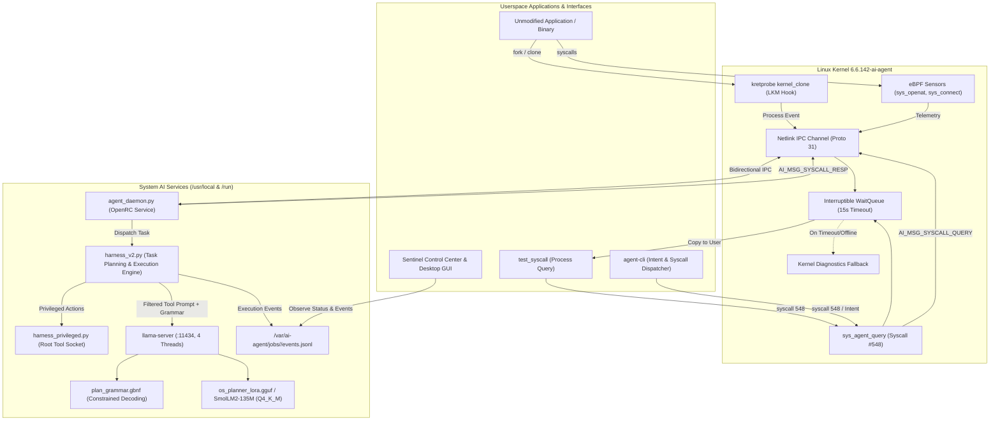

# AI-Agent OS

> An operating system architecture where an autonomous AI agent is integrated directly into the Linux kernel and process lifecycle, allowing any process to be observed, understood, and directed without application-level APIs, plugins, or MCP.

*Contain. Compute. Conquer.*

[]()
[]()
[-blue.svg)]()
[-orange.svg)]()
[]()

---

## The Core Vision

Modern AI assistants integrate with applications via plugins, APIs, or protocols like MCP (Model Context Protocol). This requires every application to be explicitly rewritten or adapted to support AI.

**AI-Agent OS flips this model:**
> **The integration point is the operating system itself, not the application.**

Every process - legacy binaries, CLI tools, services, scripts, containers - must execute system calls through the kernel. By embedding an agent at the OS layer, the system provides:

- **Universal Observability:** Intercept process events and syscall activity without application knowledge.
- **Synchronous Kernel-AI Syscall (`sys_agent_query` #548):** Any program can query the operating system's built-in reasoning engine natively.
- **Harness v2.3 Autonomous Task Execution Engine:** Decomposes complex user goals into policy-checked, verified DAG execution plans across 38 native OS tools.
- **Grammar-Constrained Decoding:** In-guest `llama-server` utilizes `plan_grammar.gbnf` to guarantee 100% syntactically valid JSON plans from compact edge models.
- **Self-Contained In-Guest Inference:** Powered by native musl `llama.cpp` and fine-tuned `SmolLM2-135M-Instruct` (`os_planner_lora.gguf`), operating completely offline with zero host or cloud dependencies.
- **Continuous Telemetry & Fine-Tuning Pipeline:** Every query, latency metric, and verdict is logged to `/var/ai-agent/` in JSONL format for domain-adapted LoRA distillation.

---

## Hardware Requirements

Because AI-Agent OS runs a local LLM inference engine (`llama-server`) directly inside the guest VM alongside a graphical desktop and kernel telemetry sensors, requirements scale based on desired workload:

### Minimum Requirements (Basic Task Execution)

*Runs default `SmolLM2-135M-Instruct` agent, Alpine Linux, and XFCE4 desktop.*

- **CPU:** 2+ Cores (x86_64 with VT-x/AMD-V virtualization enabled)
- **RAM:** 2 GB
- **Storage:** 5 GB available space
- **GPU:** None required (LLM runs on CPU, GUI uses software rendering)

### Recommended Requirements (Sentinel Control Center & High-Throughput ReAct)

*Enables WHPX hardware acceleration, large multi-step execution chains, and Sentinel AI Dashboard.*

- **CPU:** 4-8 Cores (Modern processor with WHPX or KVM hardware acceleration)
- **RAM:** 8 GB+
- **Storage:** 20 GB SSD (For `.gguf` weights, LoRA adapters, and JSONL datasets)
- **GPU:** Optional (NVIDIA RTX GPU with CUDA 12.4+ on host for high-speed offline fine-tuning via `distillation-fine-tuning`)

---

## System Architecture



---

## Harness v2.3 Autonomous Task Execution Engine

The core task execution engine (`agent-daemon/harness_v2.py`) provides an autonomous, verified execution runtime designed specifically for small local models:

### 1. Three-Tier Execution Hierarchy

The planner attempts three tiers in order before failing:

1. **Deterministic Compiler (`deterministic_plan()`)**: Zero-latency regex compiler matching 28 recurring OS task patterns (file search, system health, service restarts, directory creation) without LLM overhead.
2. **LLM Structured Plan**: Schema-validated JSON plan generated by the local fine-tuned model via `llama-server`.
3. **Command Fallback (`command.argv`)**: Safely extracts single shell argument vectors from raw LLM output when structured parsing is unavailable.

### 2. Native OS Tool Catalogue (38 Tools Across 9 Intent Categories)

Tools are partitioned into strict permission tiers:

- **Read-Only (21 Tools - Auto-Allowed)**:
  `system.info`, `disk.status`, `memory.status`, `package.query`, `service.status`, `service.logs`, `port.inspect`, `file.read`, `file.query`, `file.list`, `http.check`, `http.get`, `dir.query`, `command.argv`, `llm.prompt`, `data.csv_read`, `document.read`, `email.read`, `browser.navigate`, `browser.dump`, `browser.screenshot`.
- **Change (17 Tools - Verification & Approval Required)**:
  `package.install`, `service.start`, `service.restart`, `service.stop`, `service.enable`, `service.disable`, `dir.create`, `dir.remove`, `file.write`, `file.append`, `file.move`, `file.delete`, `shell.script`, `data.csv_write`, `email.send`, `browser.click`, `browser.type`.

### 3. Dynamic Intent-Based Tool Subsetting

Small models easily suffer from attention dilution when presented with dozens of tool schemas. `harness_v2.classify_intent_categories()` inspects the user intent and dynamically restricts the system prompt's tool catalog to the 1-3 relevant categories (e.g., `files`, `coding`, `service`). This shrinks prompt tokens by ~70% and prevents the model from hallucinating irrelevant tools.

### 4. Grammar-Constrained Decoding (`plan_grammar.gbnf`)

When calling `llama-server`, the request embeds a custom GBNF grammar (`plan_grammar.gbnf`). The sampler enforces grammar constraints at every token generation step, guaranteeing:

- 100% syntactically valid JSON output.
- Exact match against registered tool names.
- Valid step structure including `step_id`, `tool`, `args`, `risk`, `depends_on`, and `verify`.

### 5. DAG Execution, Scratchpad Chaining, and Mandatory Verification

- **Step Dependencies (`depends_on`)**: Steps execute in DAG topological order. Independent read-only steps execute in parallel via thread pools.
- **Scratchpad Interpolation**: Outputs from preceding steps are stored in the job scratchpad and interpolated dynamically in downstream steps via `${scratchpad.<variable>}`.
- **Mandatory Verification**: Every state-modifying action (`risk: "change"`) must declare an explicit verification block (`verify: {"tool": ..., "args": ...}`). If verification fails, the step is marked failed and sent to self-repair.

### 6. Dynamic Phase Chunking and Bounded Self-Repair

- **Chunked Phase Decomposition**: Complex multi-part requests are decomposed into sequential phase milestones, preventing model context overflow.
- **Bounded Self-Repair Loop**: If a step fails, `harness_v2` triggers an automated diagnosis and repair cycle (`MAX_REPAIRS_PER_STEP=3`), giving the model the failure output and prompting a targeted replacement plan.

---

## Model Fine-Tuning and Distillation Pipeline

To specialize `SmolLM2-135M-Instruct` for the OS harness, the companion repository [`distillation-fine-tuning`](https://github.com/PushkarP-404/distillation-fine-tuning) provides an end-to-end training and export pipeline:

1. **Synthetic Dataset Generator (`generate_planning_dataset.py`)**: Produces 1,500 validated task scenarios across all 9 categories with 0 schema errors.
2. **ChatML Formatter (`format_planning_dataset.py`)**: Replicates runtime `harness_v2` prompt construction with dynamic category tool catalogues.
3. **Hardware-Accelerated Training (`train_lora.py`)**: Uses CUDA FP16 mixed precision on NVIDIA RTX GPUs (~6.8s/step, 27 minutes total). Achieved 99.61% token accuracy and 0.0200 eval loss with 2048 sequence budget.
4. **Quantized GGUF Export (`export_gguf.py`)**: Merges LoRA weights and quantizes to `Q4_K_M`, producing `os_planner_lora.gguf` (100.57 MB).

---

## Quick Start: Booting the OS Appliance

The appliance is distributed as a pre-built QCOW2 image: `ai-agent-os-v0.1.qcow2`.

### Host Requirements

- [QEMU](https://www.qemu.org/) (`qemu-system-x86_64`) installed.
- 4 GB host RAM.
- Virtualization enabled (WHPX on Windows, KVM on Linux).

### One-Command Boot

**Windows (PowerShell):**

```powershell
# Headless mode
.\boot.ps1

# Graphical Desktop Mode (Seamless 1:1 Tablet Mouse Sync)
.\boot.ps1 -Gui
```

**Linux / macOS (Bash):**

```bash
# Headless mode
chmod +x boot.sh
./boot.sh

# Graphical Desktop Mode
GUI=1 ./boot.sh
```

The system automatically initializes:

1. Direct Syslinux kernel boot: `Linux 6.6.142-ai-agent`.
2. Starts native `llama-server` on `127.0.0.1:11434`.
3. Starts `agent_daemon.py` and registers Netlink PID with the kernel.
4. Starts `sshd` and forwards SSH to `localhost:2222`.
5. Starts LightDM autologin into XFCE4 desktop for `aiuser`.

### Accessing the Guest

- **SSH Access:** `ssh -p 2222 root@127.0.0.1` (Password: `root`)
- **Local LLM Health Check:** `http://127.0.0.1:11434/health`
- **Dispatching Tasks via CLI:**

  ```bash
  agent-cli "check disk usage and list top 5 large log files in /var/log"
  ```

---

## Sentinel Control Center (GUI)

The OS appliance includes a graphical desktop environment (XFCE4 + LightDM) with autologin for `aiuser`:

- **Seamless Mouse Synchronization:** Configured with `xf86-input-libinput` and `/etc/X11/xorg.conf.d/50-qemu-tablet.conf`. When booted with `-device virtio-tablet-pci -usb -device usb-tablet -vga virtio -display sdl`, the cursor coordinates map 1:1 to host mouse coordinates with zero acceleration drift or clipping.
- **Sentinel AI Dashboard:** Launch from desktop terminal:

  ```bash
  python3 /root/os-ai-agent/dashboard/dashboard.py
  ```

---

## Automated System Verification Harness

Validate the entire OS stack (kernel, syscall, daemon, inference server, eBPF sensors) with the automated test suite:

```bash
/root/os-ai-agent/test_phase6_boot.sh
```

### Verification Output

```
==================================================
    AI-Agent OS: Boot Validation Harness
==================================================
[PASS] Running custom kernel: 6.6.142-ai-agent
[PASS] llama-server and llama-cli installed in /usr/local/bin
[PASS] All dynamic library dependencies resolved for llama-server
[PASS] GGUF model present at /var/lib/ai-agent/models/os_planner_lora.gguf
[PASS] agent_daemon.py installed and executable at /usr/local/lib/ai-agent/agent_daemon.py
[PASS] harness_v2.py registered with 38 validated tools
[PASS] llama-server registered in default runlevel
[PASS] ai-agent registered in default runlevel
[PASS] sshd registered in default runlevel
[PASS] llama-server /health returned healthy status
[PASS] Kernel confirmed daemon registration in dmesg
[PASS] syscall(548) successfully routed to LLM and returned response
[PASS] All kernel edge-case validations passed (NULL pointers, invalid memory)
[PASS] Telemetry event log active at /var/ai-agent/jobs/

==================================================
           Boot Validation Summary
==================================================
  Total Passed: 14
  Total Failed: 0
  Warnings:     0
  RESULT: ALL BOOT VALIDATIONS PASSED! [SUCCESS]
==================================================
```

---

## Invoking the Syscall from C

Any userspace program can query the operating system agent natively:

```c
#include <stdio.h>
#include <string.h>
#include <unistd.h>
#include <sys/syscall.h>

#define SYS_AGENT_QUERY 548

int main(void) {
    char response[512] = {0};
    const char *query = "Checking process safety and resource state.";

    long ret = syscall(SYS_AGENT_QUERY, 0 /* target PID */, query, strlen(query), response, sizeof(response));
    if (ret >= 0) {
        printf("Kernel AI Agent Verdict: %s\n", response);
    } else {
        perror("sys_agent_query failed");
    }
    return 0;
}
```

---

## Native Alpine APK Packaging

The system components are modularized into Alpine Linux APK packages:

```
packaging/
├── ai-agent-daemon/                 # Daemon, Harness v2.3, OpenRC services
├── ai-agent-kernel-modules/         # Out-of-tree LKM hooks
├── ai-agent-model-lora/             # Fine-tuned GGUF planner adapter
├── llama-server-musl/               # Static musl llama.cpp binaries
├── build_all.sh                     # Compiles packages via abuild
└── sync_repo.py                     # Syncs packages and index to guest VM
```

---

## Repository Structure

```
os-ai-agent/
├── agent-daemon/                    # Userspace Agent Services & Harness
│   ├── agent_daemon.py              # Unified Netlink daemon (Process events + Syscall #548)
│   ├── harness_v2.py                # Harness v2.3 DAG planning and verified tool engine
│   ├── harness_privileged.py        # Root-owned UNIX socket broker for CHANGE tools
│   ├── plan_grammar.gbnf            # GBNF grammar for constrained llama-server decoding
│   ├── logger.py                    # Telemetry and JSONL event logger
│   └── openrc/                      # OpenRC service scripts
│       ├── llama-server             # Native musl inference server service
│       └── ai-agent                 # Unified agent daemon service
├── agent-cli/                       # Phase 8 Intent CLI
│   ├── agent-cli.c                  # Invokes Syscall #548 to dispatch JSON intents
│   └── Makefile
├── custom-kernel/                   # Custom Linux Kernel Source & Headers
│   ├── kernel/ai_agent.c            # sys_agent_query (#548) implementation
│   └── include/uapi/linux/ai_agent.h# UAPI syscall and Netlink definitions
├── kernel-module/                   # Loadable Kernel Module (LKM)
│   └── ai_process_hook.c            # kretprobe hook on kernel_clone
├── ebpf_sensors/                    # Phase 10 Context-Aware Observer
│   └── os_state_sensor.py           # eBPF sensor capturing openat/connect syscalls
├── ptrace-monitor/                  # Phase 1 Userspace Monitor
│   └── monitor.c                    # ptrace-based syscall interceptor
├── packaging/                       # Native Alpine APK package definitions
├── test-programs/                   # Syscall Validation Programs
│   ├── test_syscall.c               # Single-process & edge-case test
│   └── test_syscall_stress.c        # Multi-threaded concurrent stress test
├── boot.ps1                         # Windows PowerShell one-command boot launcher
├── boot.sh                          # Linux / macOS Bash one-command boot launcher
├── test_phase6_boot.sh              # Boot validation harness
├── AI_Agent_OS_Technical_Documentation.md # Exhaustive technical architecture & reference
└── README.md
```

---

## Contributing and Security Disclosures

Since this project introduces kernel-level changes (custom system calls, Netlink IPC hooks, and eBPF probes), security and reliability are top priorities.

We welcome code review, bug reports, and pull requests:

- Please open an issue in the repository with a detailed reproduction case.
- For sensitive security disclosures, please contact the maintainers directly before public posting.

---

## License

Because this project includes modifications to the Linux kernel (custom system calls, kretprobes, and loadable kernel modules), it is distributed under the **GNU General Public License v2.0 (GPL-2.0)**.

See the [LICENSE](LICENSE) file for more details. Other included third-party tools (like `llama.cpp`) retain their respective original licenses.
