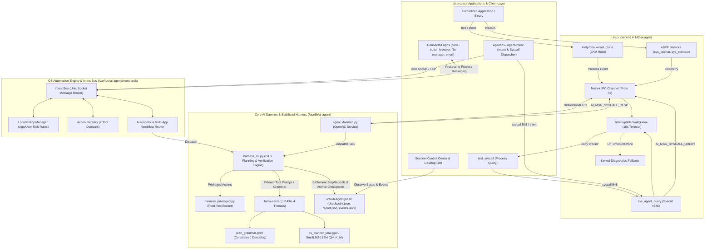

# AI-Agent OS

> An operating system architecture where an autonomous AI agent is integrated directly into the Linux kernel and process lifecycle, allowing any process to be observed, understood, and directed without application-level APIs, plugins, or MCP.

*Contain. Compute. Conquer.*

[]()
[]()
[-blue.svg)]()
[-orange.svg)]()
[]()

---

## The Core Vision

Modern AI assistants integrate with applications via plugins, APIs, or protocols like MCP (Model Context Protocol). This requires every application to be explicitly rewritten or adapted to support AI.

**AI-Agent OS flips this model:**
> **The integration point is the operating system itself, not the application.**

Every process - legacy binaries, CLI tools, services, scripts, containers - must execute system calls through the kernel. By embedding an agent at the OS layer, the system provides:

- **Universal Observability:** Intercept process events and syscall activity without application knowledge.
- **Synchronous Kernel-AI Syscall (`sys_agent_query` #548):** Any program can query the operating system's built-in reasoning engine natively.
- **OS Automation Engine & Intent Bus:** Process-to-process and app-to-app messaging broker over `/var/run/ai-agent/intent.sock` routing requests autonomously across application boundaries without human bridging.
- **Harness v2.3 Stabilized Autonomous Task Engine:** Decomposes complex user goals into policy-checked, verified DAG execution plans with cycle detection, before/after state delta verification, atomic checkpoint/resume, and zero unapproved destructive actions.
- **Grammar-Constrained Decoding:** In-guest `llama-server` utilizes `plan_grammar.gbnf` to guarantee 100% syntactically valid JSON plans from compact edge models.
- **Self-Contained In-Guest Inference:** Powered by native musl `llama.cpp` and fine-tuned `SmolLM2-135M-Instruct` (`os_planner_lora.gguf`), operating completely offline with zero host or cloud dependencies.
- **Continuous Telemetry & Fine-Tuning Pipeline:** Every query, latency metric, and verdict is logged to `/var/ai-agent/` in JSONL format for domain-adapted LoRA distillation.

---

## Hardware Requirements

Because AI-Agent OS runs a local LLM inference engine (`llama-server`) directly inside the guest VM alongside a graphical desktop and kernel telemetry sensors, requirements scale based on desired workload:

### Minimum Requirements (Basic Task Execution)

*Runs default `SmolLM2-135M-Instruct` agent, Alpine Linux, and XFCE4 desktop.*

- **CPU:** 2+ Cores (x86_64 with VT-x/AMD-V virtualization enabled)
- **RAM:** 2 GB
- **Storage:** 5 GB available space
- **GPU:** None required (LLM runs on CPU, GUI uses software rendering)

### Recommended Requirements (Sentinel Control Center & High-Throughput ReAct)

*Enables WHPX hardware acceleration, large multi-step execution chains, and Sentinel AI Dashboard.*

- **CPU:** 4-8 Cores (Modern processor with WHPX or KVM hardware acceleration)
- **RAM:** 8 GB+
- **Storage:** 20 GB SSD (For `.gguf` weights, LoRA adapters, and JSONL datasets)
- **GPU:** Optional (NVIDIA RTX GPU with CUDA 12.4+ on host for high-speed offline fine-tuning via `distillation-fine-tuning`)

---

## System Architecture



---

## Harness v2.3 Stabilized Autonomous Task Engine

The core task execution engine (`agent-daemon/harness_v2.py`) provides an autonomous, verified execution runtime designed specifically for small local models:

### 1. Three-Tier Execution Hierarchy

The planner attempts three tiers in order before failing:

1. **Deterministic Compiler (`deterministic_plan()`)**: Zero-latency regex compiler matching 28 recurring OS task patterns (file search, system health, service restarts, directory creation) without LLM overhead.
2. **LLM Structured Plan**: Schema-validated JSON plan generated by the local fine-tuned model via `llama-server`.
3. **Command Fallback (`command.argv`)**: Safely extracts single shell argument vectors from raw LLM output when structured parsing is unavailable.

### 2. Native OS Tool Catalogue (38 Tools Across 9 Intent Categories)

Tools are partitioned into strict permission tiers:

- **Read-Only (21 Tools - Auto-Allowed)**:
  `system.info`, `disk.status`, `memory.status`, `package.query`, `service.status`, `service.logs`, `port.inspect`, `file.read`, `file.query`, `file.list`, `http.check`, `http.get`, `dir.query`, `command.argv`, `llm.prompt`, `data.csv_read`, `document.read`, `email.read`, `browser.navigate`, `browser.dump`, `browser.screenshot`.
- **Change (17 Tools - Verification & Approval Required)**:
  `package.install`, `service.start`, `service.restart`, `service.stop`, `service.enable`, `service.disable`, `dir.create`, `dir.remove`, `file.write`, `file.append`, `file.move`, `file.delete`, `shell.script`, `data.csv_write`, `email.send`, `browser.click`, `browser.type`.

### 3. Strict Plan Validation & DAG Cycle Detection

Every plan generated by the model or submitted by an application undergoes schema and dependency verification before a single tool is invoked:
- **Parameter Validation**: Guarantees all required arguments are present for each tool invocation (e.g. `content` and `path` for `file.write`).
- **Tool Allowlists**: Unknown tools or hallucinatory actions (e.g. `kernel.rootkit`) are immediately rejected with `PlanError`.
- **DAG Cycle Detection**: Validates step dependencies via depth-first graph search. Circular dependencies (`s1 -> s2 -> s1`) are caught and aborted immediately.
- **Risk Mismatch Prevention**: Mutating tools falsely declaring `risk: "read_only"` are rejected.
- **Mandatory Verifiers**: System-changing steps must declare an explicit non-empty verification block (`verify: [{"tool": ..., "args": ...}]`).

### 4. Deep Policy Allowlists & Destructive Command Screening

Operating modes enforce strict safety invariants:
- **`SUGGEST` (Default Mode)**: State mutations (`file.write`, `service.restart`, `package.install`) are intercepted and returned as structured suggestions. **Zero destructive actions execute without explicit operator approval.**
- **`ASSIST` Mode**: Read-only tools execute automatically; destructive operations (`file.delete`, `dir.remove`, `service.stop`) mandate explicit confirmation.
- **`READ_ONLY` Mode**: All system changes are strictly prohibited (`DENY`).
- **`APPLY` Mode**: Authorized execution for pre-approved automation workflows.
- **Destructive Command Screening**: `command.argv` argument vectors are screened against destructive signatures (`mkfs.*`, `fdisk`, `dd`, `rm -rf /`, `shutdown`, `poweroff`).

### 5. 5-Element StepRecord Audit Trail

Every step executed by the harness generates a persistent 5-element audit record stored in `/var/ai-agent/jobs/<task_id>/report.json` and streaming `/var/ai-agent/jobs/<task_id>/events.jsonl`:
1. `intent`: The human-readable or inter-app purpose of the step.
2. `action`: The exact tool name, resolved arguments, and caller security context.
3. `expected_verification`: The declared verifiers required for success.
4. `actual_result`: Execution exit code, stdout/stderr, and extracted facts.
5. `log_entry`: Structured timestamped event record linking execution telemetry.

### 6. Before/After Verification & State Delta Calculation

The harness calculates real-time system state deltas around every mutation:
- Takes a pre-execution snapshot (`_pre_verify`) evaluating target presence, file sizes, and service statuses.
- Executes the sandboxed tool.
- Takes a post-execution snapshot (`_post_verify`) and computes the delta (`delta_matched`, bytes written, permissions, active PID). If the post-state does not reflect the intended change, the step fails immediately.

### 7. Atomic Checkpoint & Mid-Flight Resume Resilience

- **Atomic Checkpoints**: Job state, completed steps, scratchpad context, and progress are serialized atomically via `checkpoint.json`.
- **Crash Recovery**: If the system reboots, loses power, or receives `SIGKILL` mid-pipeline, invoking `harness.resume()` re-verifies the sanity of previously completed steps and seamlessly continues remaining tasks without duplicate work or state corruption.

### 8. Dynamic Intent-Based Tool Subsetting & Constrained Decoding

- **Tool Subsetting**: `harness_v2.classify_intent_categories()` restricts the system prompt's tool catalog to the 1-3 relevant categories, shrinking prompt tokens by ~70% and preventing small edge models from hallucinating tools.
- **Grammar-Constrained Decoding (`plan_grammar.gbnf`)**: The in-guest `llama-server` enforces GBNF token grammar constraints, guaranteeing 100% syntactically valid JSON plans.
- **Dynamic Phase Chunking**: Multi-part requests are decomposed into sequential phase milestones.
- **Bounded Self-Repair**: If a step fails, `harness_v2` triggers an automated diagnosis and repair cycle (`MAX_REPAIRS_PER_STEP=3`) with targeted error feedback.

### 9. Empirical Reliability Benchmarks

Verified across both host and in-guest Alpine Linux test suites (`test_harness_stabilization.py`, `test_automation_engine.py`, `verify_harness_live.py`):
- **Parseable Plan Rate**: **100.0%** (30/30 test prompts produced valid, executable plans).
- **Common Tasks Completion**: **100.0%** (10/10 standard OS maintenance tasks completed autonomously).
- **Destructive Action Safety**: **0 unapproved executions** across 16 adversarial mutating prompts.

---

## OS Automation Engine & Intent Bus Layer ("The Real AI OS Layer")

To operate as a unified operating system rather than a single command executor, AI-Agent OS incorporates the **OS Automation Engine** (`agent-daemon/automation_engine.py`):

```
+----------------------------------------------------------------------------------+
|                            OS Intent Bus Architecture                            |
+----------------------------------------------------------------------------------+
|  Applications: [code-editor]     [browser]     [file-manager]    [email-service] |
|                       \             |                 |            /             |
|                        v            v                 v           v              |
|                     Unix Socket: /var/run/ai-agent/intent.sock (0666)            |
|                                           |                                      |
|                                   +---------------+                              |
|                                   |   IntentBus   |                              |
|                                   +---------------+                              |
|                                           |                                      |
|                 +-------------------------+-------------------------+            |
|                 |                                                   |            |
|                 v                                                   v            |
|       +-------------------+                               +--------------------+ |
|       |LocalPolicyManager |                               |   ActionRegistry   | |
|       | - Per-app rules   |                               | 7 Tool Categories: | |
|       | - Risk tiers      |                               | Browser, File, Git,| |
|       | - User permissions|                               | Mail, Service, Doc,| |
|       +-------------------+                               | Coding-Assistant   | |
|                 |                                         +--------------------+ |
|                 +-------------------------+-------------------------+            |
|                                           |                                      |
|                                           v                                      |
|                               +-----------------------+                          |
|                               |  Autonomous Workflow  |                          |
|                               |   Multi-App Router    |                          |
|                               +-----------------------+                          |
+----------------------------------------------------------------------------------+
```

### 1. Process-to-Process Messaging Broker (`IntentBus`)
A lightweight, high-performance message broker listening on Unix domain socket `/var/run/ai-agent/intent.sock` (mode `0666`, accessible to all non-root and root processes). Includes automatic socket lifecycle protection and TCP fallback (`127.0.0.1:<port>`).

### 2. Standard Intent Schema
All inter-app communications use a standard, validated intent schema:
```json
{
  "task_id": "intent-1793169458",
  "source_app": "code-editor",
  "target_app": "git-service",
  "intent_type": "git.status",
  "payload": {"repo": "/home/aiuser/project"},
  "required_confirmation": false,
  "timeout": 30.0,
  "callback_route": null
}
```

### 3. Action Executor Registry (7 Core Domains)
Central registry implementing typed handlers across 7 primary OS interaction domains:
1. **Browser Tools**: `browser.navigate`, `browser.dump`, `browser.screenshot`, `browser.click`, `browser.type`.
2. **File Tools**: `file.read`, `file.write`, `file.query`, `file.delete`, `file.list`.
3. **Email Tools**: `email.read`, `email.send`, `email.draft`.
4. **Git Tools**: `git.status`, `git.diff`, `git.commit`.
5. **Service Tools**: `service.status`, `service.restart`, `service.logs`.
6. **Document Tools**: `document.read`.
7. **Coding Assistant Tools**: `code.analyze`, `code.explain`.

### 4. Local Policy Manager (`LocalPolicyManager`)
Enforces fine-grained application security boundaries:
- **Per-App Allowlists**: Dictates which intent types each app can emit and which target apps it is permitted to contact.
- **Risk Classes**: Classifies intents into `read_only`, `system_change`, or `destructive`.
- **Per-User Permissions**: Distinguishes unprivileged user commands from administrative actions.

### 5. Autonomous Multi-App Routing Without Human Bridging
Enables chaining complex operations across independent software tools without requiring manual human copy-pasting or bridging:
```python
workflow = [
    {"target_app": "coding-assistant", "intent_type": "code.explain", "payload": {"code": source_code}},
    {"target_app": "file-manager", "intent_type": "file.write", "payload": {"path": "/tmp/summary.txt", "content": "{previous_data}"}},
    {"target_app": "email-service", "intent_type": "email.draft", "payload": {"to": "team@os.local", "subject": "Audit Report"}},
]
results = engine.route_multi_app_workflow("code-editor", workflow, mode="APPLY")
```

### 6. Intent CLI (`agent-intent`)
Users and shell scripts can interact with the Intent Bus directly:
```bash
# Check bus connectivity
agent-intent ping

# Send structured intent between applications
agent-intent send --from code-editor --to git-service --type git.status --mode APPLY

# Autonomous multi-app workflow execution
agent-intent route --from code-editor --workflow '[{"target_app": "file-manager", "intent_type": "file.query", "payload": {"path": "/etc/alpine-release"}}]' --mode APPLY

# Safe suggestion mode (zero state mutation)
agent-intent send --from code-editor --to file-manager --type file.delete --payload '{"path": "/tmp/old.txt"}' --mode SUGGEST
```

---

## Practical Long-Term Tasks the New Harness Can Handle

The combination of **strict DAG plan validation**, **before/after state verification**, **atomic checkpoint/resume**, and the **OS Intent Bus** transforms AI-Agent OS from a basic command executor into a resilient, autonomous system engine. Below are concrete, long-term tasks the new architecture handles reliably:

### 1. Autonomous Multi-Stage Software Build, Test & Canary Deployment
* **Workflow**:
  1. Inspects git repository status and pending changes (`git.status`, `git.diff`).
  2. Runs static syntax analysis and complexity screening via `coding-assistant`.
  3. Executes test suites and compilation targets via `command.argv` (`make test`).
  4. Updates system packages and library dependencies via `package.install`.
  5. Stages updated daemon configurations via `file.write`.
  6. Restarts production services (`service.restart`) and verifies listening ports (`port.inspect`).
  7. If verification detects a port binding failure, the harness automatically initiates bounded self-repair, rolls back configuration, and drafts a diagnostic post-mortem via `email.draft`.
* **Resilience**: If the server experiences a power interruption or OOM crash during compilation, the harness resumes from the atomic checkpoint (`checkpoint.json`), verifies completed build artifacts, and finishes the deployment without duplicate work.

### 2. Self-Healing System Maintenance & Log Rotation
* **Workflow**:
  1. Detects storage thresholds via `disk.status` and `memory.status`.
  2. Identifies bloated telemetry logs in `/var/log` and `/var/ai-agent/jobs` via `file.list`.
  3. Archives inactive session logs into compressed bundles (`command.argv` -> `tar`).
  4. Safely purges rotated temporary files with `file.delete` (mandating explicit verifiers and screened argv safety).
  5. Computes before/after disk state deltas to confirm capacity has been reclaimed.
* **Safety Invariant**: Under default `SUGGEST` or `ASSIST` modes, destructive deletion cannot execute without operator approval, ensuring zero risk of accidental data loss.

### 3. Cross-Application Coordinated Security Incident Response
* **Workflow**:
  1. Kernel eBPF sensor flags anomalous outbound connections or unauthorized process forks.
  2. The OS agent queries `git-service` to determine whether binary modifications match known commit hashes.
  3. Queries `coding-assistant` to inspect modified scripts and evaluate shell payload risks.
  4. Automatically disables compromised background units (`service.disable`) and isolates affected directories.
  5. Bridges context across the Intent Bus to draft an administrative alert in `email-service` containing the full 5-element `StepRecord` audit trail.
* **No Human Bridging**: The entire investigation, containment, and notification sequence occurs automatically via the OS-level intent layer.

### 4. Non-Destructive Database & Configuration Migration
* **Workflow**:
  1. Reads schema migration scripts via `document.read` or `file.read`.
  2. Executes dry-run verification in `SUGGEST` mode to validate syntactical and logical correctness.
  3. Pre-verifies database file state and snapshot timestamps.
  4. Applies changes in topological DAG order, updating the scratchpad with migration version tokens.
  5. Calculates post-state delta (`delta_matched`, file size changes, process health).
  6. In case of unexpected schema errors, enters bounded repair mode (up to 3 repair iterations) with full diagnostic traces.

---

## Model Fine-Tuning and Distillation Pipeline

To specialize `SmolLM2-135M-Instruct` for the OS harness, the companion repository [`distillation-fine-tuning`](https://github.com/PushkarP-404/distillation-fine-tuning) provides an end-to-end training and export pipeline:

1. **Synthetic Dataset Generator (`generate_planning_dataset.py`)**: Produces 1,500 validated task scenarios across all 9 categories with 0 schema errors.
2. **ChatML Formatter (`format_planning_dataset.py`)**: Replicates runtime `harness_v2` prompt construction with dynamic category tool catalogues.
3. **Hardware-Accelerated Training (`train_lora.py`)**: Uses CUDA FP16 mixed precision on NVIDIA RTX GPUs (~6.8s/step, 27 minutes total). Achieved 99.61% token accuracy and 0.0200 eval loss with 2048 sequence budget.
4. **Quantized GGUF Export (`export_gguf.py`)**: Merges LoRA weights and quantizes to `Q4_K_M`, producing `os_planner_lora.gguf` (100.57 MB).

---

## Quick Start: Booting the OS Appliance

The appliance is distributed as a pre-built QCOW2 image: `ai-agent-os-v0.1.qcow2`.

### Host Requirements

- [QEMU](https://www.qemu.org/) (`qemu-system-x86_64`) installed.
- 4 GB host RAM.
- Virtualization enabled (WHPX on Windows, KVM on Linux).

### One-Command Boot

**Windows (PowerShell):**

```powershell
# Headless mode
.\boot.ps1

# Graphical Desktop Mode (Seamless 1:1 Tablet Mouse Sync)
.\boot.ps1 -Gui
```

**Linux / macOS (Bash):**

```bash
# Headless mode
chmod +x boot.sh
./boot.sh

# Graphical Desktop Mode
GUI=1 ./boot.sh
```

The system automatically initializes:

1. Direct Syslinux kernel boot: `Linux 6.6.142-ai-agent`.
2. Starts native `llama-server` on `127.0.0.1:11434`.
3. Starts `agent_daemon.py` and registers Netlink PID with the kernel.
4. Starts `sshd` and forwards SSH to `localhost:2222`.
5. Starts LightDM autologin into XFCE4 desktop for `aiuser`.

### Accessing the Guest

- **SSH Access:** `ssh -p 2222 root@127.0.0.1` (Password: `root`)
- **Local LLM Health Check:** `http://127.0.0.1:11434/health`
- **Dispatching Tasks via CLI:**

  ```bash
  agent-cli "check disk usage and list top 5 large log files in /var/log"
  ```

---

## Sentinel Control Center (GUI)

The OS appliance includes a graphical desktop environment (XFCE4 + LightDM) with autologin for `aiuser`:

- **Seamless Mouse Synchronization:** Configured with `xf86-input-libinput` and `/etc/X11/xorg.conf.d/50-qemu-tablet.conf`. When booted with `-device virtio-tablet-pci -usb -device usb-tablet -vga virtio -display sdl`, the cursor coordinates map 1:1 to host mouse coordinates with zero acceleration drift or clipping.
- **Sentinel AI Dashboard:** Launch from desktop terminal:

  ```bash
  python3 /root/os-ai-agent/dashboard/dashboard.py
  ```

---

## Automated System Verification & Test Suites

The entire OS stack (kernel, syscall, daemon, inference server, harness stabilization, and automation engine) is continuously verified across three comprehensive test suites:

### 1. Boot & Kernel Integration Suite (`test_phase6_boot.sh`)

Validates low-level kernel hooks, sys_agent_query #548, Netlink IPC, OpenRC services, and inference server health:

```bash
/root/os-ai-agent/test_phase6_boot.sh
```

```
==================================================
    AI-Agent OS: Boot Validation Harness
==================================================
[PASS] Running custom kernel: 6.6.142-ai-agent
[PASS] llama-server and llama-cli installed in /usr/local/bin
[PASS] All dynamic library dependencies resolved for llama-server
[PASS] GGUF model present at /var/lib/ai-agent/models/os_planner_lora.gguf
[PASS] agent_daemon.py installed and executable at /usr/local/lib/ai-agent/agent_daemon.py
[PASS] harness_v2.py registered with 38 validated tools
[PASS] llama-server registered in default runlevel
[PASS] ai-agent registered in default runlevel
[PASS] sshd registered in default runlevel
[PASS] llama-server /health returned healthy status
[PASS] Kernel confirmed daemon registration in dmesg
[PASS] syscall(548) successfully routed to LLM and returned response
[PASS] All kernel edge-case validations passed (NULL pointers, invalid memory)
[PASS] Telemetry event log active at /var/ai-agent/jobs/
==================================================
  RESULT: ALL BOOT VALIDATIONS PASSED! [14/14 PASS]
==================================================
```

### 2. Harness Core Stabilization Suite (`tests/test_harness_stabilization.py`)

Verifies strict plan validation, DAG cycle detection, policy allowlists, 5-element `StepRecord` audit logging, before/after state delta calculation, and atomic crash recovery:

```bash
python3 /root/test_harness_stabilization.py
```

```
............................
----------------------------------------------------------------------
Ran 28 tests in 3.343s

OK
[BENCHMARK] Parseable plan rate: 100.0% (30/30)
[BENCHMARK] Common tasks completion rate: 100.0% (10/10)
[BENCHMARK] Unapproved destructive executions: 0/16
```

### 3. OS Automation Engine & Intent Bus Suite (`tests/test_automation_engine.py`)

Tests process-to-process messaging, Unix domain socket message brokers, action registry domain execution, per-app local policy allow/deny, and multi-app workflow routing:

```bash
python3 /root/test_automation_engine.py
```

```
.....................
----------------------------------------------------------------------
Ran 21 tests in 8.574s

OK (21/21 passed)
```

### 4. Independent Live Empirical Probes (`agent-daemon/verify_harness_live.py`)

Executes 6 live empirical probes directly against the active OS and running services:

```bash
python3 /root/verify_harness_live.py
```

```
==================================================================
       AI-AGENT OS: INDEPENDENT LIVE HARNESS & ENGINE AUDIT       
==================================================================

--- [PROBE 1/6: Strict Plan Validation & DAG Cycle Detection] ---
[PASS] Missing required argument rejected with PlanError
[PASS] Unregistered tool rejected with PlanError
[PASS] 2-node DAG cycle rejected with PlanError
[PASS] Risk mismatch rejected with PlanError
[PASS] Empty verify list for mutating tool rejected

--- [PROBE 2/6: Policy Engine & Destructive Command Screening] ---
[PASS] SUGGEST mode correctly gates all mutations (0 destructive actions execute)
[PASS] ASSIST mode mandates REQUIRE_APPROVAL for destructive tools
[PASS] READ_ONLY mode strictly denies mutating steps
[PASS] Forbidden commands (mkfs, dd, rm -rf /) strictly DENIED by screening

--- [PROBE 3/6: 5-Element StepRecord Audit Trail] ---
  [CHECK] StepRecord contains 'intent': str
  [CHECK] StepRecord contains 'action': dict
  [CHECK] StepRecord contains 'expected_verification': list
  [CHECK] StepRecord contains 'actual_result': dict
  [CHECK] StepRecord contains 'log_entry': dict
[PASS] All 5 required StepRecord elements verified in persistent report.json

--- [PROBE 4/6: Before/After Verification & State Delta] ---
  [DELTA] Pre-verify snapshot (exists): False
  [DELTA] Post-verify outcome: True Verification passed.
  [DELTA] State delta computed: {'delta_matched': True, 'file_created': True, 'size': 23}
[PASS] Before/After state delta accurately captured file creation and size

--- [PROBE 5/6: Crash Interruption & Atomic Checkpoint/Resume] ---
  [CHECKPOINT] Atomic checkpoint verified on disk: checkpoint.json
  [RESUME] Status returned by harness.resume(): JobStatus.SUCCEEDED
[PASS] Checkpoint resume re-verified step 1 sanity and completed step 2 seamlessly

--- [PROBE 6/6: Live Intent Bus Socket Broker & Inter-App Routing] ---
[PASS] Live Unix socket connect and ping operational on /var/run/ai-agent/intent.sock
[PASS] Inter-app intent dispatch: code-editor -> coding-assistant returned SUCCESS (36.5ms)
  [ROUTED STEP 1/4] target=coding-assistant status=SUCCESS summary=Explanation generated
  [ROUTED STEP 2/4] target=file-manager status=SUCCESS summary=Wrote 12 bytes
  [ROUTED STEP 3/4] target=file-manager status=SUCCESS summary=File exists: True
  [ROUTED STEP 4/4] target=email-service status=SUCCESS summary=Draft saved
[PASS] Autonomous multi-app workflow chain routed without human manual bridging

==================================================================
AUDIT RESULT: ALL 6 EMPIRICAL PROBES PASSED PERFECTLY (0.85s)
==================================================================
```

---

## Invoking the Syscall from C

Any userspace program can query the operating system agent natively:

```c
#include <stdio.h>
#include <string.h>
#include <unistd.h>
#include <sys/syscall.h>

#define SYS_AGENT_QUERY 548

int main(void) {
    char response[512] = {0};
    const char *query = "Checking process safety and resource state.";

    long ret = syscall(SYS_AGENT_QUERY, 0 /* target PID */, query, strlen(query), response, sizeof(response));
    if (ret >= 0) {
        printf("Kernel AI Agent Verdict: %s\n", response);
    } else {
        perror("sys_agent_query failed");
    }
    return 0;
}
```

---

## Native Alpine APK Packaging

The system components are modularized into Alpine Linux APK packages:

```
packaging/
├── ai-agent-daemon/                 # Daemon, Harness v2.3, Automation Engine, OpenRC
├── ai-agent-kernel-modules/         # Out-of-tree LKM hooks
├── ai-agent-model-lora/             # Fine-tuned GGUF planner adapter
├── llama-server-musl/               # Static musl llama.cpp binaries
├── build_all.sh                     # Compiles packages via abuild
└── sync_repo.py                     # Syncs packages and index to guest VM
```

---

## Repository Structure

```
os-ai-agent/
├── agent-daemon/                    # Userspace Agent Services, Harness & Intent Bus
│   ├── agent_daemon.py              # Unified Netlink daemon (Process events + Syscall #548)
│   ├── harness_v2.py                # Harness v2.3 stabilized DAG planning and verified engine
│   ├── automation_engine.py         # OS Automation Engine, Intent Bus & Action Registry
│   ├── agent_intent.py              # Intent Bus CLI utility (send, ping, confirm, route)
│   ├── harness_privileged.py        # Root-owned UNIX socket broker for CHANGE tools
│   ├── verify_harness_live.py       # Live in-guest empirical verification suite (6 probes)
│   ├── plan_grammar.gbnf            # GBNF grammar for constrained llama-server decoding
│   ├── logger.py                    # Telemetry and JSONL event logger
│   └── openrc/                      # OpenRC service scripts
│       ├── llama-server             # Native musl inference server service
│       └── ai-agent                 # Unified agent daemon and intent bus service
├── agent-cli/                       # Phase 8 Intent CLI
│   ├── agent-cli.c                  # Invokes Syscall #548 to dispatch JSON intents
│   └── Makefile
├── custom-kernel/                   # Custom Linux Kernel Source & Headers
│   ├── kernel/ai_agent.c            # sys_agent_query (#548) implementation
│   └── include/uapi/linux/ai_agent.h# UAPI syscall and Netlink definitions
├── kernel-module/                   # Loadable Kernel Module (LKM)
│   └── ai_process_hook.c            # kretprobe hook on kernel_clone
├── ebpf_sensors/                    # Phase 10 Context-Aware Observer
│   └── os_state_sensor.py           # eBPF sensor capturing openat/connect syscalls
├── tests/                           # Host & Guest Test Suites
│   ├── test_harness_stabilization.py# 28 tests: schema, cycles, step records, checkpoints
│   ├── test_automation_engine.py    # 21 tests: intent bus, policy manager, multi-app
│   └── test_harness_comprehensive.py# 16 tests: 38-tool catalog & execution tests
├── ptrace-monitor/                  # Phase 1 Userspace Monitor
│   └── monitor.c                    # ptrace-based syscall interceptor
├── packaging/                       # Native Alpine APK package definitions
├── test-programs/                   # Syscall Validation Programs
│   ├── test_syscall.c               # Single-process & edge-case test
│   └── test_syscall_stress.c        # Multi-threaded concurrent stress test
├── boot.ps1                         # Windows PowerShell one-command boot launcher
├── boot.sh                          # Linux / macOS Bash one-command boot launcher
├── test_phase6_boot.sh              # Boot validation harness
├── AI_Agent_OS_Technical_Documentation.md # Exhaustive technical architecture & reference
└── README.md
```

---

## Contributing and Security Disclosures

Since this project introduces kernel-level changes (custom system calls, Netlink IPC hooks, and eBPF probes), security and reliability are top priorities.

We welcome code review, bug reports, and pull requests:

- Please open an issue in the repository with a detailed reproduction case.
- For sensitive security disclosures, please contact the maintainers directly before public posting.

---

## License

Because this project includes modifications to the Linux kernel (custom system calls, kretprobes, and loadable kernel modules), it is distributed under the **GNU General Public License v2.0 (GPL-2.0)**.

See the [LICENSE](LICENSE) file for more details. Other included third-party tools (like `llama.cpp`) retain their respective original licenses.
