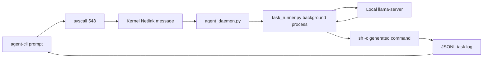
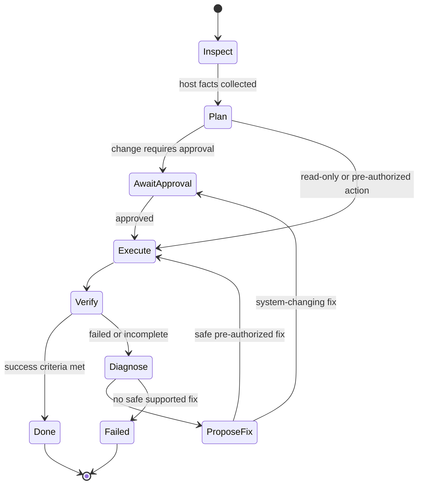

# Agent CLI Harness Analysis

## Conclusion

`agent-cli "<prompt>"` has the wiring needed to launch a task, but it is not yet a dependable autonomous task harness. It can submit an intent to syscall 548, dispatch a background Python runner, ask the local model for a command, run that command, and stream a JSONL task log back to the terminal. That is useful proof of the execution path.

It does **not** currently implement the required behavior for a general prompt: understand the desired end state, safely carry out all needed steps, detect problems, diagnose their cause, apply or propose a fix, and verify the final outcome. The present worker exits successfully after the first shell command that returns exit code zero. A command can succeed while failing to accomplish the requested task.

The code should be treated as an experimental, privileged command executor until the remediation plan below is implemented and tested in the QEMU guest.

## Current execution path



The actual flow is as follows:

1. `agent-cli` sends its quoted prompt through syscall 548 and waits only for a task ID and JSONL log path.
2. `agent_daemon.py` recognizes calls from `agent-cli`, selects `ASSIST` or `SUGGEST` mode, and spawns `task_runner.py` in the background.
3. `task_runner.py` discovers caller context from `/proc/<pid>`, requests one shell command from the local LLM, filters that command through a small deny-list, then runs it using `sh -c`.
4. The CLI polls the JSONL file and prints plan, command, stdout/stderr, and a terminal task status.

Relevant implementation points:

| Component | Evidence | Current responsibility |
| --- | --- | --- |
| `agent-cli/agent-cli.c` | `main()` and `stream_task_log()` | Submits one natural-language intent and renders task-log events. |
| `agent-daemon/agent_daemon.py` | `handle_syscall_query()` | Creates task ID, starts the background runner, and replies to syscall 548. |
| `agent-daemon/task_runner.py` | `run_worker_task()` | Asks the model for commands and runs them. |
| `agent-daemon/task_runner.py` | `main()` | Creates a one-item `task_list = [intent]`; it does not actually plan a multi-step task. |

## What works today

- The task handoff avoids the kernel response size limit by returning a task ID and reading results from JSONL.
- `SUGGEST` mode explicitly avoids execution.
- The runner records individual command stdout, stderr, return codes, timeouts, model output, and a final task event.
- Caller UID/GID, home directory, working directory, and environment are sampled from `/proc`, then non-root callers are executed with their UID/GID.
- Per-command and total task time limits exist (30 seconds and five minutes, respectively).
- A limited deny-list prevents several catastrophic command forms such as filesystem formatting and obvious destructive `rm -rf /` variants.
- The existing CLI display distinguishes normal result, failed result, security block, and final job status.

These are good building blocks for a controlled harness. They are not sufficient guarantees of task completion or safe remediation.

## Gaps against the requested behavior

### 1. The planner is only a log message

The code writes `planner_start` and `plan` events, but `task_runner.py` always assigns `task_list = [intent]`. It does not call the LLM for a structured plan, divide a request into steps, attach success criteria, or create a dependency graph.

Impact: prompts such as `install nginx, configure it, start it, and verify it serves a page` cannot be reliably completed. At most, the model is asked to emit one command per iteration, and the first successful command ends the task.

### 2. A successful command is incorrectly treated as a successful task

In `run_worker_task()`, after `subprocess.run()` returns zero, the runner immediately writes `task_finish` and returns success. It never asks: "Did this accomplish the user's requested outcome?"

Example: for `install curl and test it`, `apk add curl` returning zero ends the job. `curl --version` is never run. For `fix the web service`, `rc-service nginx start` can return zero even when the service immediately exits or cannot accept connections.

### 3. There is no problem diagnosis or fix loop

On a non-zero exit code or timeout, the runner adds the stderr text to `history_ctx` and asks the LLM again. It has no required schema for the model to identify a cause, collect targeted evidence, rank safe fixes, apply one, then verify it. After three steps it reports only `Task failed to complete within step limit`.

The CLI therefore displays raw stderr but cannot report a reliable answer to:

- what failed;
- why it failed;
- whether the root cause is known or only suspected;
- which fix was attempted;
- whether the fix worked;
- what the user should do if an action needs approval.

### 4. LLM output parsing is fragile

The worker prompt already ends with `{"cmd": "`, then code prepends the same prefix to any response that does not start with it. The remaining text can be incomplete JSON, quoted incorrectly, or contain additional prose. `extract_action()` then uses permissive JSON, regex, markdown, quoted-command, and raw-line fallbacks.

Impact: a small local model can generate malformed output which the fallbacks turn into an unexpected command. The documented live audit records unreliable output from the 135M model, including a one-character answer in an earlier system path. The daemon fixed some stop-token behavior, but the task runner uses a different `_llm_post()` implementation and response contract.

### 5. `sh -c` gives the model broad shell authority

The worker executes model text through `subprocess.run(["sh", "-c", shell_cmd], ...)`. The deny-list is a blacklist with a few regular expressions. It does not prevent destructive commands through alternate syntax, command substitution, pipes, encoded payloads, package maintainer scripts, privilege escalation paths, or exfiltration commands.

The caller-context feature also does not enforce a task-level authorization policy. If `agent-cli` runs as root, the model's command runs as root. That makes a misparsed or injected command highly consequential.

### 6. The report is telemetry, not an actionable result

`agent-cli` renders several event types but omits `ai_raw`, `json_error`, and the final `done.summaries` details. It does not render a structured final report with goal, commands run, evidence, diagnosis, changes made, verification results, unresolved problems, or a recovery/rollback description.

The current final result can say `SUCCESS` after a single zero-exit command, giving a false sense of completion.

### 7. Capability discovery is unused for decision making

The daemon records some installed commands, package manager, init system, and OS information in `capabilities.json`. The runner logs those capabilities but never puts them into the worker prompt or uses them to select safe tools, validate prerequisites, or reject unsupported requests.

### 8. No persistent task state or recovery

Task logs are append-only but there is no state machine, command idempotency key, cancellation mechanism, durable checkpoint, or recovery after daemon/VM restart. A task that modifies configuration then crashes cannot distinguish complete, partial, and rolled-back changes.

## Risk assessment

| Priority | Finding | Consequence | Required direction |
| --- | --- | --- | --- |
| P0 | Model text executes through `sh -c` with a blacklist | Arbitrary, potentially root-level changes from an unreliable command generator | Replace free-form shell execution with typed tools and an allowlist. |
| P0 | No explicit authorization policy by action class | Read-only requests and system-changing requests enter the same executor | Add policy gates for package, service, filesystem, network, and privileged actions. |
| P0 | Zero command exit means task success | Reports success when the requested result was never checked | Require success criteria and a final verification stage. |
| P1 | No diagnosis/remediation schema | Failure output is opaque and fixes are inconsistent | Require structured observation, diagnosis, proposed action, result, and confidence. |
| P1 | Planner is absent | Multi-step tasks stop after one successful command | Implement a real plan with explicit actions and verification checkpoints. |
| P1 | Fragile output extraction | Malformed model text can become a command | Use JSON Schema/tool calls and reject invalid output; never recover by guessing commands from prose. |
| P1 | No test suite for harness behavior | Claims of autonomy cannot be measured or safely regressed | Add deterministic fake-model and guest integration tests. |
| P2 | Capability registry is not passed to executor | Commands may assume unavailable tools or wrong platform | Build a typed host inventory and expose it to planning/tool validation. |
| P2 | Final CLI report lacks diagnosis/verification | User cannot tell what happened or what to fix | Render a concise structured outcome report. |

## Target harness design

Use a state machine with an explicit contract instead of free-form shell generation:



Each plan step should be a typed object, validated before execution. For example:

```json
{
  "goal": "Install curl and prove it runs",
  "success_criteria": ["curl is installed", "curl --version exits 0"],
  "steps": [
    {"tool": "package.install", "args": {"packages": ["curl"]}, "risk": "system_change"},
    {"tool": "command.run", "args": {"argv": ["curl", "--version"]}, "risk": "read_only"}
  ]
}
```

The LLM may choose from approved tools and explain its reasoning, but an executor owns command construction. Shell support, if retained, should be a restricted `argv` tool with no shell parsing, a small allowlist, working-directory constraints, maximum output limits, and a risk classification. Do not convert unstructured model prose into executable shell code.

For every failure, the task record should capture:

```json
{
  "step": "start nginx",
  "observed_failure": {"returncode": 1, "stderr": "..."},
  "diagnosis": {"cause": "port 80 already in use", "confidence": 0.93, "evidence": ["ss output", "service log"]},
  "proposed_fix": {"tool": "service.stop", "args": {"name": "apache2"}, "risk": "system_change"},
  "verification": {"tool": "http.check", "args": {"url": "http://127.0.0.1/"}}
}
```

The harness must distinguish a diagnosis from a hypothesis. If it cannot establish a likely cause safely, it should report the evidence and request targeted user direction rather than guess a fix.

## Recommended implementation order

### Milestone 1: Make outcomes truthful

1. Define `Task`, `Step`, `Evidence`, `Diagnosis`, `Change`, and `Verification` JSON schemas.
2. Add statuses: `PLANNED`, `RUNNING`, `NEEDS_APPROVAL`, `VERIFYING`, `SUCCEEDED`, `FAILED`, `CANCELLED`.
3. Remove success-on-first-zero-exit behavior. A task succeeds only when every declared success criterion has passed.
4. Render the final structured report in `agent-cli`, including unresolved failures and suggested manual fixes.

### Milestone 2: Restrict execution

1. Replace `sh -c` with typed operations for package management, services, file inspection, process/network inspection, and approved file edits.
2. Define which operations are read-only, reversible changes, privileged changes, and prohibited operations.
3. Enforce action policy using the caller identity and a configuration file; log the rule that allowed or blocked each action.
4. Use `argv` execution for the remaining command tool and reject shell operators (`|`, `>`, `;`, `$()`, backticks, redirects) unless implemented by a specific safe tool.

### Milestone 3: Add diagnose-fix-verify behavior

1. On a failed execution or verification, collect fixed diagnostic facts appropriate to the tool: stderr, service status, recent logs, process/listening-port state, disk/memory facts, and relevant configuration parse errors.
2. Give the model a strict diagnosis schema containing evidence references and confidence.
3. Permit one safe remediation attempt per diagnostic category, then re-run the failed verification.
4. Stop with `FAILED` or `NEEDS_APPROVAL` after bounded attempts; report the safest next action and exact evidence.

### Milestone 4: Test it in layers

1. Unit-test schema validation, policy classification, tool argument validation, log events, and final-status calculation using a fake model.
2. Add deterministic integration tests in an Alpine VM for success, missing dependency, package failure, bad configuration, port conflict, permission error, command timeout, invalid model JSON, service crash, and runner restart.
3. Add end-to-end acceptance tests that assert both a system state and the final human-readable report.
4. Keep the existing syscall tests, but do not treat kernel round-trip success as proof that the task harness works.

## Acceptance criteria for the requested feature

The harness can claim this feature only when these are automated and passing in the guest:

| Scenario | Required outcome |
| --- | --- |
| `agent-cli "install curl and test it"` | Installs curl only when allowed, runs `curl --version`, and reports both evidence items. |
| Start a service with a deliberately bad config | Detects start/health failure, reports the exact configuration evidence, proposes or applies an allowed fix, and verifies the service afterward. |
| Port conflict | Identifies the owning process from observed port state and offers a policy-approved resolution; it does not blindly kill a process. |
| Model emits malformed JSON | Executes nothing and reports a model-protocol error. |
| Unsupported or unsafe request | Executes nothing, explains the policy restriction, and gives a safe alternative when available. |
| Command exits 0 but success criterion fails | Marks the task failed or incomplete and shows failed verification evidence. |
| Runner crash mid-task | Leaves a recoverable state record and reports that task completion is unknown until inspected/recovered. |

## Source evidence reviewed

- `os-ai-agent/agent-cli/agent-cli.c`
- `os-ai-agent/agent-daemon/agent_daemon.py`
- `os-ai-agent/agent-daemon/task_runner.py`
- `os-ai-agent/docs/Testing_and_Tracing_Guide.md`
- `os-ai-agent/docs/Deep_Testing_Report.md`
- `os-ai-agent/README.md`

