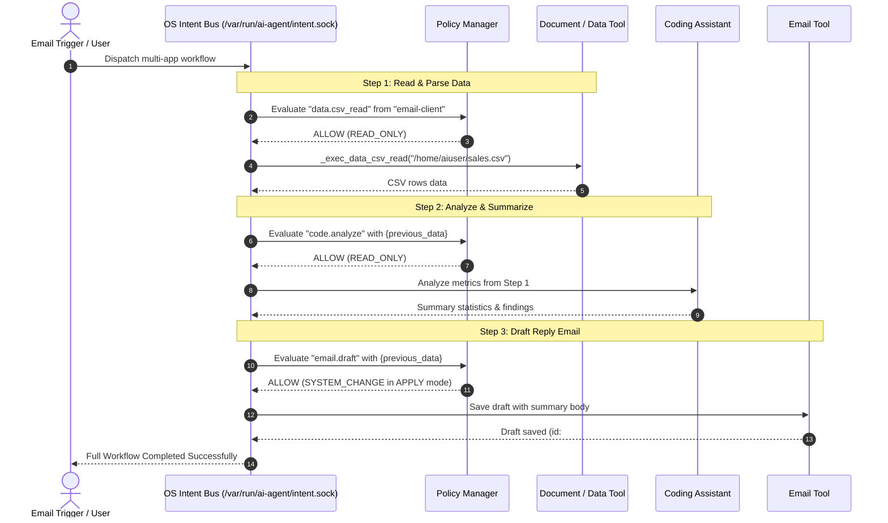

# Elenchus Harness & Intent Bus: Architecture and App Communication Guide

This document provides a clear, detailed explanation of how the **Elenchus Task Harness (v2.3)** operates, how it interacts with applications on the system, and how **application-to-application communication** is orchestrated via the **OS Intent Bus**.

---

## 1. Executive Summary: The Big Picture

In standard operating systems, applications live in isolated silos. When an AI agent tries to control an OS, it usually relies on raw, brittle shell commands or blind mouse-clicking. 

Elenchus takes a fundamentally different approach:
1. **The LLM is strictly the planner** (deciding *what* to do from a registered tool catalog).
2. **The Harness is the deterministic executor** (deciding *how* to do it safely, with zero shell string interpolation).
3. **The Intent Bus is the OS message broker** (enabling processes and GUI apps to talk directly to each other via structured protocols).

```
 ┌──────────────────────────────────────────────────────────────┐
 │                      User Request / Intent                   │
 └──────────────────────────────┬───────────────────────────────┘
                                │
                                ▼
 ┌──────────────────────────────────────────────────────────────┐
 │                   Planning Engine (Harness)                  │
 │  Tier 1: Regex Planner  ─►  Tier 2: GBNF LLM  ─►  Fallback   │
 └──────────────────────────────┬───────────────────────────────┘
                                │ Structured Plan JSON
                                ▼
 ┌──────────────────────────────────────────────────────────────┐
 │               Local Policy Manager & Sandbox                 │
 │     READ_ONLY (Safe)  │  CHANGE (Gated)  │  DESTRUCTIVE (Blocked)
 └──────────────────────────────┬───────────────────────────────┘
                                │ Validated Action
                                ▼
 ┌──────────────────────────────────────────────────────────────┐
 │                    Action Executor Registry                  │
 ├──────────────┬──────────────┬───────────────┬────────────────┤
 │   Desktop    │  Headless    │  Filesystem   │    Services    │
 │  GUI Apps    │   Browsers   │  & Documents  │    & Daemons   │
 │ (X11 / D-Bus)│ (CDP / DOM)  │ (Direct I/O)  │ (OpenRC / IPC) │
 └──────────────┴──────────────┴───────────────┴────────────────┘
                                ▲
                                │ App-to-App Events
 ┌──────────────────────────────┴───────────────────────────────┐
 │                   OS Intent Bus Message Broker               │
 │       Unix Domain Socket: /var/run/ai-agent/intent.sock      │
 └──────────────────────────────────────────────────────────────┘
```

---

## 2. How the Harness Interacts with Applications

The Harness controls system applications through four distinct interfaces:

### A. Desktop GUI Applications (`app.launch`)
When launching GUI applications (such as Chromium, Thunar file manager, Mousepad text editor, or XFCE Terminal), the agent does not execute dangerous shell strings. Instead, it interacts directly with the user's graphical desktop session:

1. **Target Session Discovery**:
   - The harness determines the target user (typically `aiuser`).
   - It inspects `/proc/<pid>/environ` of the active `xfce4-session` to discover the live `DBUS_SESSION_BUS_ADDRESS`.
2. **Display & Authorization Linking**:
   - Sets `DISPLAY=:0` (or the active virtual display).
   - Points `XAUTHORITY` to `/home/aiuser/.Xauthority` so the application has permission to draw on the X11 screen.
3. **Safe Process Spawning**:
   - The application is invoked as an exact argument array (`argv`), completely preventing shell command injection:
     ```bash
     su -s /bin/sh - aiuser -c 'exec "$@"' -- chromium --no-first-run http://127.0.0.1:8080
     ```

---

### B. Web Browser Automation (The Dual-Engine CDP Controller)
Web browsing is handled by [`cdp_controller.py`](file:///c:/qemu-alpine/os-ai-agent/agent-daemon/cdp_controller.py) via the Chrome DevTools Protocol (CDP). Elenchus uses a hybrid architecture:

| Feature | Primary Engine: **Lightpanda** (Port `9223`) | Fallback Engine: **Chromium** (Port `9222`) |
| :--- | :--- | :--- |
| **Purpose** | High-speed, headless data extraction and form interaction | Full visual rendering, screenshots, and visual feedback |
| **Resource Usage** | ~10x less RAM, instant startup | Standard browser footprint (~300MB+) |
| **DOM Inspection** | JS DOM queries injecting `data-elc-id="N"` attributes | Native Chrome Accessibility Tree (`getFullAXTree`) |
| **Element Clicking** | `document.querySelector('[data-elc-id="N"]').click()` | `DOM.resolveNode` via Chromium `backendNodeId` |
| **Screenshot** | Fallback to `scrot` / ImageMagick `import` | Native `Page.captureScreenshot` |

#### How the Interaction Cycle Works:
1. **Navigate**: `browser.navigate {url: "..."}` sends `Page.navigate` and actively polls `document.readyState` until `'complete'`.
2. **Inspect / Dump**: `browser.dump {}` lists all interactive elements (buttons, inputs, links, forms) with sequential numeric IDs.
3. **Act**: The harness issues `browser.click {id: 4}` or `browser.type {id: 2, text: "query"}`.
4. **Extract**: `browser.extract {selector: "table"}` pulls clean text without loading bulky rendering pipelines.

---

### C. Desktop Accessibility (AT-SPI)
For desktop applications that are not web browsers (e.g., text editors, file managers, system dialogs):
- The agent uses **AT-SPI (Assistive Technology Service Provider Interface)** via `atspi_dumper.py`.
- It queries the accessibility bus over D-Bus to read window titles, focused widgets, text boxes, and button labels without relying on OCR or pixel-level computer vision.

---

### D. System Services & Background Daemons
Background applications and system daemons are controlled through Alpine Linux's **OpenRC** init system:
- `service.status {name: "llama-server"}` -> queries `rc-service llama-server status`.
- `service.start` / `service.restart` -> manages service lifecycle.
- `service.logs {name: "ai-agent", lines: 50}` -> reads `/var/log/<name>.log`.

---

## 3. How App-to-App Communication Works: The OS Intent Bus

The central innovation in Elenchus is the **Intent Bus** (implemented in [`automation_engine.py`](file:///c:/qemu-alpine/os-ai-agent/agent-daemon/automation_engine.py)). It allows programs to communicate without humans copying and pasting data between windows.

### A. The Transport Layer
- **Socket Path**: `/var/run/ai-agent/intent.sock` (with `/var/ai-agent/intent.sock` as fallback).
- **Protocol**: Line-delimited JSON over a streaming **Unix Domain Socket** with world-accessible permissions (`0666`).
- **Cross-Platform Mode**: Supports an ephemeral local TCP loopback (`127.0.0.1:<port>`) for testing on non-Linux platforms.

---

### B. Standard Intent Schema (`IntentMessage`)
Every message passed across applications follows a strict, validated schema:

```json
{
  "task_id": "wf-a1b2c3d4",
  "source_app": "email-client",
  "target_app": "code-editor",
  "intent_type": "file.read",
  "payload": {
    "path": "/home/aiuser/project/main.py"
  },
  "required_confirmation": false,
  "timeout": 30.0,
  "user": "aiuser",
  "uid": 1000,
  "risk_class": "low",
  "timestamp": 1730800000.0
}
```

Every result returned to the sender follows the `IntentResponse` schema:
```json
{
  "task_id": "wf-a1b2c3d4",
  "status": "SUCCESS",
  "source_app": "email-client",
  "target_app": "code-editor",
  "summary": "Read file main.py (1420 bytes)",
  "data": { "content": "..." },
  "error": null,
  "elapsed_s": 0.042
}
```

---

### C. Local Policy Manager: Safety & Security Boundaries

Before any intent is routed or executed, it passes through the `LocalPolicyManager`:

```
Incoming Intent
      │
      ▼
1. Source App Check   ──► Is source_app authorized to send this intent_type?
      │
      ▼
2. Target App Check   ──► Is source_app authorized to contact target_app?
      │
      ▼
3. Risk Classification ──► READ_ONLY vs SYSTEM_CHANGE vs DESTRUCTIVE
      │
      ▼
4. Mode Enforcement   ──► SUGGEST (dry run)
                      ──► ASSIST (prompt user for confirmation if high-risk)
                      ──► APPLY (autonomous execution)
```

#### Risk Tiers:
- **`READ_ONLY`** (Safe, executed immediately):
  `file.read`, `file.list`, `git.status`, `browser.dump`, `browser.extract`, `document.read`, `service.status`, `system.info`.
- **`SYSTEM_CHANGE`** (Modifies user state):
  `file.write`, `git.commit`, `browser.navigate`, `browser.click`, `browser.type`, `email.draft`.
- **`DESTRUCTIVE`** (High impact; blocked in ASSIST mode unless explicitly confirmed):
  `file.delete`, `dir.remove`, `service.stop`, `package.install`, `git.push`, `email.send`, `system.reboot`.
- **`FORBIDDEN`** (Hard-blocked by kernel and harness policy):
  `dd`, `mkfs`, `fdisk`, `shred`, `wipefs`.

---

### D. App-to-App Routing Mechanisms

There are two primary ways communication occurs across applications:

#### 1. Direct Process-to-Process Messaging
When two applications are connected to the Intent Bus (e.g., a code editor plugin and a system monitor):
1. **App Registration**: `editor` connects to the socket and sends:
   ```json
   {"type": "register", "app_name": "editor", "capabilities": ["code.edit", "file.open"]}
   ```
2. **Direct Forwarding**: Another app (e.g., `git-client`) sends an intent targeting `editor`.
3. The Intent Bus identifies the active socket for `editor` and forwards:
   ```json
   {"type": "incoming_intent", "intent": { ... }}
   ```
4. `editor` processes the request and responds back over its connection.

#### 2. Service-Brokered Action Execution
If the target application is not an active connected client, the Intent Bus routes the intent to its **Action Registry**. The built-in executor runs the capability on behalf of the requesting app and returns the data.

---

## 4. End-to-End Multi-App Workflow Example

Here is how a real-world multi-application task is executed autonomously by the `MultiAppRouter`:

**Scenario**: The agent receives an email asking to inspect a data file, summarize it, and draft a response.



Notice the `{previous_data}` token: the harness automatically chains the output of Step 1 into the payload of Step 2, and Step 2 into Step 3, without requiring human intervention.

---

## 5. Reliability: Verification & Self-Correction

A key weakness of standard AI agents is failing silently or acting on stale state. Elenchus prevents this through three verification mechanisms:

1. **State Delta Verification**:
   - Before a change step runs, the harness takes a lightweight snapshot (file existence, service status, process list).
   - After execution, it re-probes the system and confirms the expected delta occurred.
2. **Grammar-Constrained Decoding (GBNF)**:
   - When calling local LLMs (`llama-server`), the harness applies `plan_grammar.gbnf`. The model's token sampling is physically constrained so it can **only** emit syntactically valid JSON matching real tools.
3. **The Bounded Repair Loop (`MAX_REPAIRS_PER_STEP = 3`)**:
   - If an element is missing or a tool fails, the harness does not abort the entire mission.
   - It captures the error output, injects it into a repair prompt, and allows the model up to 3 repair attempts to try an alternate strategy (e.g., trying a different CSS selector or falling back to Chromium).

---

## 6. Summary Reference Table

| Component | File Path | Primary Responsibility |
| :--- | :--- | :--- |
| **Harness Core** | [`agent-daemon/harness_v2.py`](file:///c:/qemu-alpine/os-ai-agent/agent-daemon/harness_v2.py) | Plan generation, DAG dependency checking, tool execution, bounded repair loop |
| **Automation Engine** | [`agent-daemon/automation_engine.py`](file:///c:/qemu-alpine/os-ai-agent/agent-daemon/automation_engine.py) | Central orchestrator managing the Intent Bus, Policy Manager, and multi-app routing |
| **Intent Bus Server** | [`agent-daemon/automation_engine.py`](file:///c:/qemu-alpine/os-ai-agent/agent-daemon/automation_engine.py#L928) | Unix Domain Socket server (`intent.sock`) for process-to-process messaging |
| **Intent Bus Client** | [`agent-daemon/automation_engine.py`](file:///c:/qemu-alpine/os-ai-agent/agent-daemon/automation_engine.py#L1290) | Python library for any local application to connect, send intents, and receive responses |
| **CDP Controller** | [`agent-daemon/cdp_controller.py`](file:///c:/qemu-alpine/os-ai-agent/agent-daemon/cdp_controller.py) | Dual-engine browser automation (Lightpanda on 9223, Chromium on 9222) |
| **Accessibility Dumper**| [`agent-daemon/atspi_dumper.py`](file:///c:/qemu-alpine/os-ai-agent/agent-daemon/atspi_dumper.py) | AT-SPI accessibility inspection for native desktop applications |
| **Plan Grammar** | [`agent-daemon/plan_grammar.gbnf`](file:///c:/qemu-alpine/os-ai-agent/agent-daemon/plan_grammar.gbnf) | GBNF grammar enforcing valid plan JSON output from local LLMs |
