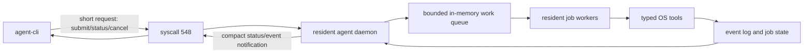
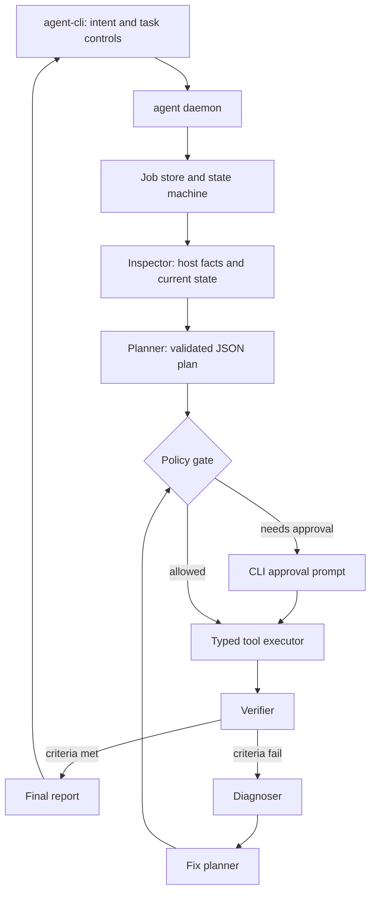

# Plan: Make `agent-cli` Follow Through on Long Instructions

## Objective

Make this command reliable for multi-step work:

```sh
agent-cli "set up a small web service, configure it, start it, test it locally, and tell me what failed and how you fixed it"
```

The harness must turn a long instruction into an explicit job, execute it in controlled steps, detect when the result differs from the goal, gather evidence, apply only permitted fixes, verify the result, and produce a final report. It should never claim success merely because an intermediate command exited successfully.

## Definition of done

For every task, the harness returns one of these meaningful outcomes:

| Status | Meaning |
| --- | --- |
| `SUCCEEDED` | Every required success criterion was verified with recorded evidence. |
| `PARTIAL` | Some requested outcomes were verified, but others could not be completed. |
| `NEEDS_APPROVAL` | The next required action changes the system and needs the user's approval. |
| `BLOCKED` | Required information, access, dependency, or supported capability is missing. |
| `FAILED` | The harness attempted allowed remediation and could not satisfy the verification criteria. |
| `CANCELLED` | The user or a policy cancelled the job before completion. |

A result must include: the goal, plan, actions taken, observed evidence, changes made, verification outcomes, unresolved issues, and safe next actions.

## Design principles

1. The model decides *what to try* from an approved set of tools; deterministic code decides *how it is executed*.
2. Every state-changing step has an explicit desired outcome and verification step.
3. Failure handling begins with observation. A diagnosis is labeled as confirmed or suspected and cites evidence.
4. Commands are not inferred from loose model prose. Invalid model output stops that step safely.
5. Long jobs are resumable. The task record is the source of truth, not an in-memory conversation.
6. Scope is bounded: a job may only affect approved paths, services, packages, ports, and time budgets.
7. The kernel provides a fast, small control interface; planning and long-running execution remain in supervised userspace.
8. Reuse facts, connections, processes, and model context within a job instead of repeatedly rediscovering state.

## OS-native streamlined workflow

The harness is part of the OS, so it should behave like an operating-system service, not a chain of independently launched scripts. The custom syscall is valuable for admission and status signaling, but it must not carry long prompts, long reports, model inference, or task execution.

### Fast path and work path



Use this division of responsibility:

| Layer | Keep it responsible for | Do not put here |
| --- | --- | --- |
| Kernel / syscall 548 | Caller identity, admission, cancellation/status signal, bounded request ID exchange. | LLM calls, JSON parsing beyond a compact protocol, filesystem changes, task logs, planner state. |
| Resident daemon | Authentication, policy, job scheduling, cache ownership, worker supervision, event fan-out. | One subprocess per tiny decision or per log event. |
| Worker pool | Plan execution, verification, diagnosis, bounded remediation. | Unbounded concurrency or untracked background processes. |
| Typed tools | Small OS actions with measured outcomes. | General shell interpretation and model-controlled command strings. |
| Model server | Planning and diagnosis only when deterministic rules cannot decide. | Repeated status polling, simple command selection, raw secrets, direct execution authority. |

### Replace the current per-job process spawn

Today `agent_daemon.py` launches one `task_runner.py` subprocess for every `agent-cli` request. Replace it with a resident worker pool owned by the OpenRC service:

- Start a small fixed pool at daemon boot: one planner/diagnostic worker and a limited number of I/O workers. A 2 vCPU appliance should begin with one active job and one queued job; a 4 vCPU appliance can use two active jobs.
- Keep the LLM HTTP client alive with connection reuse. Do not create a new request stack for each step.
- Give each job a cooperative cancellation token and its own process group only when it runs an external tool that must be terminated.
- Use a bounded queue and return `BUSY`/queued status when capacity is exhausted. This protects RAM, CPU, and the local model from contention.
- Put deadlines in a monotonic-clock scheduler. Do not rely on repeated CLI-side polling to enforce job limits.

This removes process startup cost, avoids races around log-file creation, centralizes resource accounting, and allows jobs to resume after a worker restart.

### Event-driven status streaming

The current CLI opens a JSONL file and polls it every 300 ms. Preserve JSONL as an audit artifact, but make live updates event-driven:

1. The daemon owns an in-memory event broker keyed by job ID.
2. `agent-cli` establishes a local Unix-domain socket connection after syscall submission, authenticated with peer credentials.
3. The daemon streams compact framed events only when job state changes: step started, evidence available, approval required, verification completed, diagnosis available, job completed.
4. The CLI can reconnect using the job ID and event sequence number; on reconnect it reads only missed events from the durable log.
5. Keep JSONL/`report.json` for offline inspection and support a low-frequency polling fallback only when the local stream is unavailable.

Benefits: lower wake-up rate, immediate updates, no repeated disk reads, and one unified stream for the CLI, dashboard, and later remote bridge.

### Minimize model work

The local 135M model is the slowest and least reliable part of the path. Reserve it for decisions that actually need language understanding.

- Classify common intent categories with deterministic prefix/keyword routing first: inspect, package, service, file, network, and status.
- Collect inventory once at job start, then cache individual facts with a time-to-live and invalidation keys. For example, invalidate service and port facts after a service action; do not rerun full inventory.
- Send a compact fact summary and step state to the model, not the entire task log or environment.
- Make one plan request for the job, then one diagnosis/fix request only after a verified failure. Do not call the model after every successful tool execution.
- Cache validated plans only for identical, read-only requests made by the same caller/policy context and within a short state-consistent window.
- Use deterministic verifiers and failure classifiers before invoking the model. A malformed config test or an occupied port has structured evidence that does not need an LLM to recognize it.
- Enforce strict token and response budgets; return a structured model-protocol failure if the response cannot validate.

### Make inventory and verification incremental

Do not scan the entire operating system for every instruction. The inventory service should maintain a small, typed snapshot:

```text
OS / package manager / init system       refreshed on daemon start
Installed package status                 invalidated after package actions
Named service status and recent logs     refreshed only for referenced service
Listening ports                          refreshed after service/network actions
File metadata and content hashes         refreshed only for in-scope paths
Disk and memory summary                  short TTL, refreshed on resource-related tasks
```

Use OS notifications where available:

- OpenRC service status/log hooks for service actions.
- Netlink route/link events for network state changes.
- inotify for files edited by the harness.
- Existing eBPF telemetry only as optional context after it has a reliable daemon delivery path; it must not be on the critical task-completion path.

The verifier should run the narrowest test that proves the criterion. For example, a service restart needs service state plus the expected local port/listener; an HTTP task adds one local request. It does not need a full process scan or full system inventory.

### Resource controls and scheduling

Give every job a resource envelope enforced by the daemon:

| Resource | Initial policy |
| --- | --- |
| Concurrent active jobs | 1 on the default appliance; configurable upper bound of 2 on 4 vCPUs. |
| LLM requests | One plan call, then bounded diagnosis/re-plan calls; serialize by default for the small model. |
| Job deadline | 15 minutes for an approved long job; shorter defaults by intent class. |
| Tool timeout | Per-tool limits, such as 10 seconds for inspection and 60 seconds for package/service actions. |
| Captured output | Bounded stdout/stderr plus an artifact file limit; summarize large logs. |
| Disk usage | Per-job evidence and backup quota with cleanup after a retention period. |
| CPU/memory | Run external tool process groups under `nice`/`ionice` where supported and apply cgroup limits when the guest configuration supports them. |

Assign priority by interaction type: cancellation and approval responses first, status queries second, verification and diagnostics third, new planning work last. Never starve a running job's final verification because new prompts arrive.

### Reduce syscall and IPC overhead

Keep the syscall request payload compact: operation type, job ID or a bounded initial intent, and a nonce. Return a job ID and current state immediately. Use the local socket stream for all detailed events and reports.

For the kernel-to-daemon interface:

- Register one long-lived daemon endpoint and validate registration ownership before replacing it.
- Keep kernel wait time short because long jobs must be asynchronous.
- Coalesce noncritical telemetry. Process-event and eBPF streams should be sampled/batched and never delay command submission or verification.
- Use fixed binary message structs for control messages and version them explicitly.

### Observability without a performance tax

Every event should be emitted once, structured once, then delivered to consumers. Avoid separate status formatting in the executor, JSONL writer, CLI, and dashboard.

- Produce an internal typed event with job ID, sequence number, timestamp, state transition, summary, and artifact references.
- The event broker writes it to JSONL asynchronously and sends it to connected clients.
- Store verbose tool output as bounded artifacts; place only a concise summary in the event.
- Track latency by stage: syscall admission, queue wait, inventory, plan, tool execution, verification, diagnosis, and reporting.
- Expose a health snapshot for queue depth, active jobs, worker utilization, model latency, event backlog, and failed verification count.

These metrics will show whether slow jobs are caused by the model, I/O, package downloads, a particular tool, or contention.

## Target architecture



### Core components

| Component | Responsibility | Replace or extend |
| --- | --- | --- |
| `JobStore` | Durable task record, event stream, checkpoints, cancellation, resume data. | Extend current per-task JSONL logs into structured job state. |
| `Inventory` | Collect facts about OS, packages, services, files, ports, permissions, disk, and available tools. | Extend `capabilities.json`; supply facts to plans and diagnostics. |
| `Planner` | Convert a user intent plus inventory into a typed step plan and success criteria. | Replace `task_list = [intent]`. |
| `PolicyEngine` | Decide whether a tool action is allowed, denied, or requires approval. | Replace command deny-list as the primary control. |
| `ToolExecutor` | Execute typed, validated actions without shell interpolation. | Replace `subprocess.run(["sh", "-c", ...])`. |
| `Verifier` | Test the requested outcome after each relevant change and at job completion. | New component. |
| `Diagnoser` | Collect relevant facts after a failure and form evidence-based cause hypotheses. | New component. |
| `Reporter` | Produce machine-readable JSON and a concise CLI report. | Extend the event renderer in `agent-cli.c`. |

## Job and step data model

Implement the schemas in Python first, using `dataclasses` plus JSON validation or Pydantic if it is already acceptable for the guest. Store the canonical job state as JSON and append immutable events to JSONL.

```json
{
  "job_id": "b0f12345",
  "intent": "Install nginx, serve a health page, and verify it locally",
  "status": "RUNNING",
  "requested_by": {"uid": 1000, "user": "aiuser", "cwd": "/home/aiuser"},
  "scope": {
    "allowed_paths": ["/etc/nginx", "/var/www", "/home/aiuser"],
    "allowed_services": ["nginx"],
    "max_steps": 20,
    "max_remediation_attempts": 2,
    "deadline_seconds": 900
  },
  "goal": "Nginx serves the requested health page on localhost",
  "success_criteria": [
    {"id": "package-present", "type": "package_installed", "package": "nginx"},
    {"id": "service-healthy", "type": "service_healthy", "service": "nginx"},
    {"id": "http-response", "type": "http_response", "url": "http://127.0.0.1/health", "status": 200, "contains": "ok"}
  ],
  "steps": [],
  "evidence": [],
  "report": null
}
```

Each step must include:

```json
{
  "id": "step-03",
  "purpose": "Start nginx after the configuration is installed",
  "depends_on": ["step-02"],
  "action": {"tool": "service.start", "args": {"name": "nginx"}},
  "risk": "system_change",
  "approval": "required",
  "expected_effect": "nginx is running and listening on its configured local port",
  "verify": [{"tool": "service.status", "args": {"name": "nginx"}}],
  "on_failure": "diagnose"
}
```

No plan is executable if it lacks a success criterion or each state-changing step lacks verification.

## Tool contract

Start with a small set of typed tools. Each tool validates its arguments and runs fixed `argv` commands or dedicated Python code. Tools return an `Outcome` object rather than raw print text.

```json
{
  "ok": false,
  "exit_code": 1,
  "summary": "nginx configuration check failed",
  "stdout": "...",
  "stderr": "unknown directive on line 12",
  "facts": [{"kind": "config_error", "file": "/etc/nginx/nginx.conf", "line": 12}],
  "artifacts": ["/var/ai-agent/jobs/b0f12345/evidence/nginx-test.txt"]
}
```

Initial tool categories:

| Category | Example tools | Notes |
| --- | --- | --- |
| Inspection | `file.read`, `file.list`, `package.query`, `service.status`, `process.list`, `port.inspect`, `disk.inspect`, `log.tail` | Read-only; normally run without approval. |
| Package | `package.install`, `package.remove`, `package.query` | Install/remove are separate policy actions. |
| Service | `service.start`, `service.stop`, `service.restart`, `service.status` | Only named services within job scope. |
| Files | `file.write_atomic`, `file.patch`, `file.mkdir`, `file.stat` | Restrict paths, take backup and record diff before changes. |
| Network verification | `http.check`, `tcp.check`, `dns.lookup` | Default to local/private addresses. |
| Program execution | `command.argv` | Limited commands and argument schemas; no shell grammar. |

Do not support `sh -c`, pipes, redirects, command substitution, backticks, or arbitrary scripts in the first safe version. Add a specialized tool when an actual use case requires that capability.

## Planning a long instruction

### Phase A: Normalize the request

Before model planning, parse known user controls:

- `/suggest`: inspect and propose only; do not execute.
- `/assist`: execute read-only actions and request approval for changes.
- `/apply`: execute changes allowed by the configured policy.
- `--resume <job-id>`: continue a stopped job from its last verified checkpoint.
- `--cancel <job-id>`: stop a running job cleanly.

Preserve the original intent verbatim. Separately derive goal statements and non-negotiable constraints. If the intent is ambiguous in a way that changes scope, produce a short plan and mark `NEEDS_APPROVAL` rather than inventing a target service, path, or external account.

### Phase B: Inspect before planning

Run a fixed initial inventory based on the intent category. For a service task, gather OS and package manager, existing service state, relevant configuration syntax check, active listeners, recent service logs, available disk, and caller permissions. Persist each fact with source, timestamp, and command/tool version.

The model receives these facts as read-only context. It does not receive raw secrets, complete environment variables, SSH keys, or unbounded logs.

### Phase C: Generate and validate the plan

Require a strict JSON response with:

- goal;
- assumptions;
- success criteria;
- ordered typed tool steps;
- dependencies;
- risk category and approval requirement for each step;
- verification actions;
- rollback approach for reversible changes.

Validate the plan locally. Reject it if it references an unknown tool, supplies invalid arguments, exceeds scope/budget, omits verification, or tries to bypass policy. If rejected, provide the model only the validation errors and allow one constrained re-plan. Do not extract a command from free text.

### Phase D: Show a compact execution preview

Before the first system change, the CLI should show:

```text
Goal: Serve the health page locally through nginx
Plan: 5 steps; 2 system changes; 3 verification checks
Next change: install package nginx
Why: nginx is not currently installed
Approval: required
```

For policy-required actions, wait for an explicit CLI confirmation that includes the exact affected package/service/path. Continue automatically only for actions the user has already authorized by mode and policy.

## Execution and checkpoint loop

For each plan step:

1. Re-check preconditions because state may have changed since planning.
2. Ask `PolicyEngine` whether this exact action is allowed.
3. Record `STEP_STARTED`, including a redacted action description and state hash.
4. Run the typed tool with timeout, output limit, and resource limits.
5. Store outputs as evidence artifacts; place short redacted summaries in the event stream.
6. Run declared verification actions, regardless of whether the action command returned zero.
7. Mark `STEP_SUCCEEDED` only if verification passes. Persist a checkpoint with the changed state and rollback metadata.
8. If execution or verification fails, enter the diagnosis loop.

The runner should not terminate after any intermediate success. It terminates only when every success criterion has passed, the job becomes blocked, or bounded attempts are exhausted.

## Diagnosis and repair loop

### 1. Collect evidence deterministically

Map failure types to inspection tools. Examples:

| Failed verification | Required evidence |
| --- | --- |
| Service not healthy | service status, recent bounded logs, config syntax check, process state, port inspection |
| HTTP check fails | listener/port state, DNS resolution, service status, recent logs, local curl output |
| Package install fails | package manager output, repository configuration summary, disk state, network/DNS check |
| Permission error | file owner/mode, parent directory mode, caller identity, relevant service user |
| File write fails | target path state, filesystem free space, mount mode, policy decision |
| Timeout | process tree, bounded command output, resource snapshot, service state |

### 2. Diagnose with explicit confidence

The model receives evidence references and must return structured hypotheses:

```json
{
  "problem": "nginx did not start",
  "hypotheses": [
    {
      "cause": "A malformed directive exists at /etc/nginx/nginx.conf:12",
      "confidence": 0.96,
      "evidence_ids": ["ev-27", "ev-28"],
      "classification": "confirmed"
    }
  ],
  "next_inspection": [],
  "safe_fix_options": []
}
```

Only a `confirmed` cause may trigger an automatic safe fix. A `suspected` cause should trigger more inspection or a user-facing recommendation.

### 3. Plan a bounded repair

The fix planner can choose only tools and paths within job scope. Each repair has a separate approval classification and verification. Record a maximum of two repair cycles per root cause and four per job. This avoids infinite loops and repeated destructive experimentation.

### 4. Report the failure honestly

If repair cannot proceed, report:

- the failed criterion;
- observed evidence;
- confirmed cause or best hypothesis with confidence;
- changes attempted and their effects;
- the next safe manual action;
- whether task state changed and where rollback data resides.

## Durable state, resume, and cancellation

Store jobs under `/var/ai-agent/jobs/<job-id>/`:

```text
job.json                 # current canonical state
events.jsonl             # append-only lifecycle log
plan.json                # validated plan revision
evidence/                # bounded command/tool output artifacts
backups/                 # files saved before permitted changes
report.json              # final machine-readable report
```

Rules:

- Atomic-write `job.json` after every state transition.
- Include `plan_revision`, step attempt number, and state hash in every event.
- On startup, mark an interrupted `RUNNING` job as `RECOVERY_REQUIRED`, inspect actual state, then either resume from the last verified checkpoint or report `PARTIAL`.
- `agent-cli --status <job-id>` renders the latest state without changing it.
- `agent-cli --resume <job-id>` must ask for approval again if the next action is a new system change.
- `agent-cli --cancel <job-id>` sends a cancellation request, terminates the active child process group, and records the final known state.

## CLI experience

Keep the live stream concise. Show action and result details while running, then emit a final report.

```text
[JOB b0f12345] Goal: Serve /health locally through nginx
[1/5] Inspect nginx state ... complete
[2/5] Install nginx ... approval required
Apply `apk add nginx`? [y/N] y
[2/5] Install nginx ... verified
[3/5] Write health page ... verified
[4/5] Start nginx ... verification failed
      Cause: nginx configuration line 12 has an unknown directive (confirmed)
      Fix: remove directive from /etc/nginx/nginx.conf [requires approval]
[4/5] Fix applied ... verified
[5/5] GET http://127.0.0.1/health ... 200, body contains "ok"

RESULT: SUCCEEDED
Changes: installed nginx; wrote /var/www/health; updated /etc/nginx/nginx.conf
Evidence: package present; service running; HTTP 200 at /health
```

In `SUGGEST` mode, output the same plan, risk labels, and verification criteria but record all state-changing steps as proposed instead of running them.

## Implementation sequence

### Milestone 0: Establish baseline tests

Add a fake LLM server and test fixture layer before changing behavior. It must return deterministic valid plans, malformed plans, tool errors, and diagnostic hypotheses. This makes harness tests independent of the 135M model's variable output.

Deliverables:

- `tests/fake_llm.py` or an equivalent local fixture.
- Golden JSONL job traces for success, failed verification, repair, blocked, malformed plan, timeout, and cancellation.
- A short compatibility test confirming existing syscall 548 dispatch still returns a task ID.

### Milestone 1: Job store and status model

Replace ad hoc `TaskLog` status handling with `JobStore` and the status enum above. Keep JSONL events for streaming compatibility, but derive them from validated state transitions.

Deliverables:

- `job_store.py`, `models.py`, and atomic persistence.
- Job status, inspect, resume, and cancel CLI commands.
- Migration path for old `/var/ai-agent/tasks/*.jsonl` files: preserve them read-only; do not attempt to resume legacy tasks.

### Milestone 2: Typed tools and policy engine

Implement inspection tools first, then package/service tools, then constrained file tools. Create `/etc/ai-agent/policy.json` with per-user/group permissions and command/path/service allowlists.

Deliverables:

- `tools/` package with schemas and fixed `argv` construction.
- `policy.py` returning `ALLOW`, `DENY`, or `REQUIRE_APPROVAL` with a reason.
- Removal of the permissive shell extraction fallbacks from `task_runner.py`.
- Audit log of every policy decision.

### Milestone 3: Plan/execute/verify loop

Build the planner contract and validation layer. Make every state-changing action declare a precondition, expected effect, and verifier. Convert the runner from "one command and return" to a state machine.

Deliverables:

- Strict plan schema and re-plan error handling.
- Precondition and success-criterion evaluator.
- Final task status based on verified criteria, never a command return code alone.

### Milestone 4: Diagnosis and repair

Add failure-to-inspection mappings, structured diagnosis, repair-plan validation, and bounded retry rules.

Deliverables:

- Evidence collector with output redaction and size limits.
- Diagnosis schema with evidence IDs, confidence, and confirmed/suspected labels.
- Repair execution with approval and post-repair verification.

### Milestone 5: CLI report and operational controls

Update `agent-cli.c` to render the richer job events and final report. Support `--status`, `--resume`, `--cancel`, and an explicit approve command. Ensure the CLI exits non-zero for `PARTIAL`, `BLOCKED`, `FAILED`, and `CANCELLED`.

Deliverables:

- Clear final report including evidence references and recommended action.
- Correct shell exit codes for automation.
- Human-readable recovery and rollback instructions.

### Milestone 6: Guest validation and hardening

Run deterministic tests, then QEMU integration tests with the real services. Start in `SUGGEST` mode and use a non-root test user. Expand authorization only after the tests pass.

Deliverables:

- Test matrix below running in the appliance.
- Soak test with cancel/restart/recovery scenarios.
- Updated user and developer documentation.

## Test matrix

| Case | Expected system result | Expected report result |
| --- | --- | --- |
| Install and validate a package | Package exists and validation command passes | `SUCCEEDED` with installation and validation evidence. |
| Service has invalid configuration | Service remains stopped until a permitted repair is applied | Confirmed syntax error, exact evidence, repair and verification or `NEEDS_APPROVAL`. |
| Port already in use | No unrelated process is stopped automatically | Owning process identified; conflict reported; approved option proposed. |
| Command returns 0 but wrong outcome | No false success | Failed criterion with evidence; diagnose/fix loop begins. |
| Invalid plan or model JSON | No action runs | `BLOCKED` or `FAILED` with model-protocol error. |
| Package repository unavailable | No partial config change | Network/repository evidence, retry policy result, manual fix. |
| Permission denied | No escalation by model | Caller/path permissions reported and approval/policy route explained. |
| Runner restarts after file change | State recovered from checkpoint | `RECOVERY_REQUIRED`, then an inspected resume or `PARTIAL`. |
| User cancels a job | Active child process group stops | `CANCELLED` with final known state. |
| Out-of-scope instruction | No out-of-scope mutation | `NEEDS_APPROVAL` or `BLOCKED` with scope explanation. |

## Suggested first vertical slice

Build one complete workflow before supporting arbitrary tasks:

```text
Inspect a named OpenRC service -> read its status and logs -> restart it only with approval -> verify it is active and listening -> diagnose a failed start -> report a confirmed configuration or port problem.
```

It exercises the full architecture without needing arbitrary file edits, browser control, package installation, or broad shell execution. Once that works deterministically, add package installation and constrained configuration editing as separate vertical slices.

## Files expected to change

| File or area | Change |
| --- | --- |
| `os-ai-agent/agent-daemon/task_runner.py` | Refactor into the durable job state machine; remove free-form shell execution and success-on-zero-exit behavior. |
| `os-ai-agent/agent-daemon/agent_daemon.py` | Dispatch job controls and pass authenticated caller/policy context. |
| `os-ai-agent/agent-cli/agent-cli.c` | Add approval, status, cancel, resume, and structured final report rendering. |
| `os-ai-agent/agent-daemon/` | Add job models, policy engine, inventory, tools, verifier, diagnoser, and reporter modules. |
| `os-ai-agent/agent-daemon/openrc/` | Ensure service user, job directory ownership, and recovery behavior match the new policy model. |
| `os-ai-agent/test-programs/` and new tests | Add deterministic harness unit and QEMU integration coverage. |
| New `/etc/ai-agent/policy.json` | Define authorization, allowed scopes, approval rules, and resource limits. |

## Rollout strategy

1. Ship the new engine disabled behind `HARNESS_V2=0`; keep the current runner only for regression comparison in an isolated development image.
2. Run V2 in `SUGGEST` mode against a library of known tasks and compare its plan and diagnosis reports with expected results.
3. Enable read-only tools for a non-root test user.
4. Enable one approved reversible change workflow, such as service restart, with explicit CLI approval.
5. Expand tool categories only after their test matrix and rollback behavior pass in QEMU.
6. Remove or disable the old `sh -c` executor before the harness is offered as autonomous task execution.
